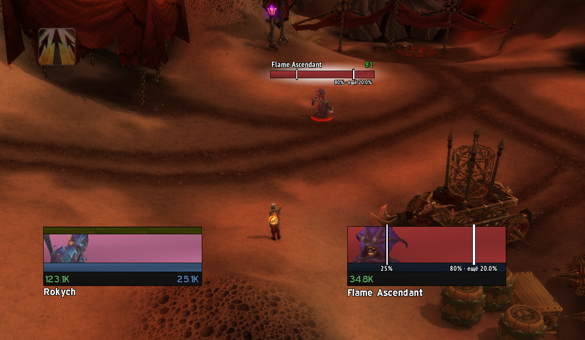
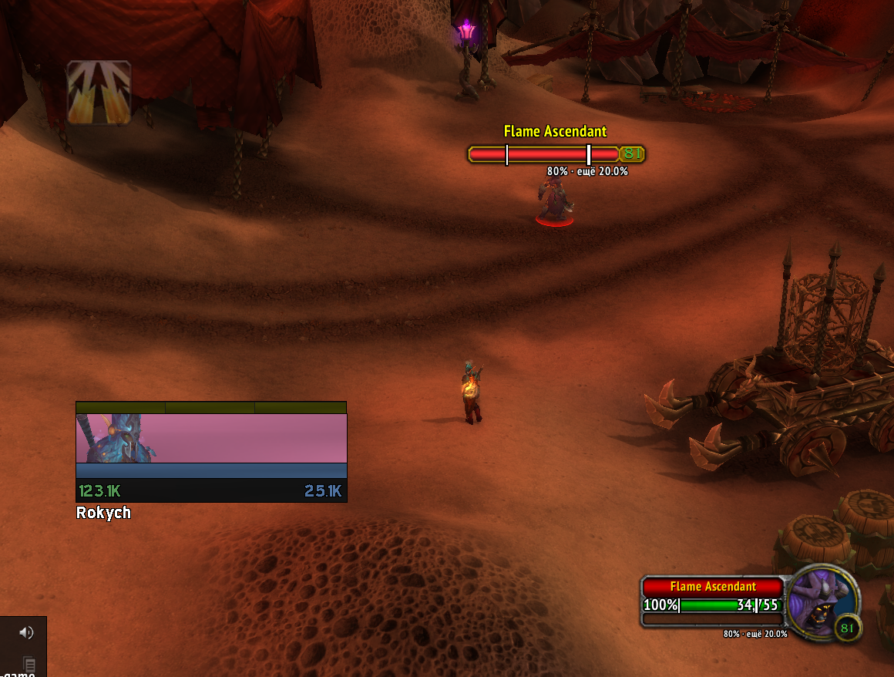

# Hogwarts Phase Marks

Аддон гильдии **Hogwarts** для WoW Cataclysm. Ставит на полосы здоровья боссов засечки в точках, где начинается новая фаза или событие. Под каждой засечкой подписан процент, а у ближайшего порога видно, сколько ещё осталось до него.

## Как это выглядит

**ElvUI**: рамка цели и неймплейт

**Стандартные рамки Blizzard**: рамка цели и неймплейт

> На скриншотах включён тестовый режим `/hpm test`: на любой цели показываются засечки Al'Akir (80% и 25%).

## Установка

1. Скачайте [HogwartsPhaseMarks.zip](https://github.com/zlobinilya1998/hogwarts-phase-marks/releases/latest/download/HogwartsPhaseMarks.zip). По этой ссылке всегда лежит последняя версия.
2. Распакуйте архив в `<папка игры>\Interface\AddOns`. Внутри архива уже есть папка `HogwartsPhaseMarks`, переименовывать ничего не нужно.
3. Перезапустите игру и проверьте, что аддон включён в списке аддонов.

Чтобы обновить аддон, скачайте архив заново и распакуйте его поверх старой версии. Ваши настройки при этом сохранятся.

Через **WowUp**: «Get Addons → Install from URL», адрес `https://github.com/zlobinilya1998/hogwarts-phase-marks`. Дальше WowUp будет обновлять аддон сам.

> Не скачивайте аддон кнопкой «Code → Download ZIP». В таком архиве папка называется `hogwarts-phase-marks-main`, и игра его не увидит.

## Что показывает

- **Засечка** стоит на пороге фазы. Белая засечка означает смену фазы, золотая — событие (например, Furious Roar у Halfus). У засечки есть тёмная обводка, поэтому её видно на полосе любого цвета.
- **Подпись** показывает процент порога и, если задана, короткую заметку: `20% Furious`.
- **Следующий порог** выделен: засечка толще, а в подписи указан остаток, например `40% · ещё 7.8%`.
- **Пройденные пороги** становятся полупрозрачными.
- **Мигание**: засечка следующего порога начинает мигать, когда до него остаётся 10% HP.
- **Героические пороги** показываются только на героической сложности.

Засечки появляются на рамках цели, фокуса и боссов (`boss1`–`boss8`) и на неймплейтах. Поддерживаются и стандартные рамки Blizzard, и ElvUI.

## Боссы по умолчанию

| Рейд | Босс | Пороги |
|---|---|---|
| Blackwing Descent | Magmaw / Exposed Head of Magmaw | 30% Нефариан (героик) |
| | Chimaeron | 20% Mortality |
| | Maloriak | 25% |
| The Bastion of Twilight | Halfus Wyrmbreaker | 50% Furious Roar (событие) |
| | Feludius, Ignacious | 25% фаза 2 |
| | Arion, Terrastra | 25% фаза 3 |
| | Cho'gall | 25% |
| | Sinestra | 30% |
| Throne of the Four Winds | Al'Akir | 80%, 25% |
| Baradin Hold | Argaloth | 66%, 33% Fel Firestorm (события) |
| Firelands | Shannox | 30% Frenzied Devotion (событие) |
| | Lord Rhyolith | 25% |
| | Ragnaros | 70%, 40%, 10% (героик) |
| Dragon Soul | Morchok | 90% Kohcrom (героик, событие), 20% Furious (событие) |
| | Kohcrom | 20% Furious (событие) |
| | Madness of Deathwing | 20% |

Список можно менять в игре, см. ниже.

## Настройка

Окно настройки открывается командой `/hpm` или кнопкой «Открыть настройки» в «Настройки → AddOns → Hogwarts Phase Marks».

### Вкладка «Боссы»

- **Добавить босса**: возьмите NPC в цель и нажмите «Цель» или введите npc id и нажмите «По ID».
- **Имя босса** можно изменить.
- **Пороги**: до 8 на босса. У каждого порога:
  - **HP %**: можно дробное значение, например `33.5`;
  - **Героик**: порог показывается только на героической сложности;
  - **Событие**: золотая засечка вместо белой;
  - **Подпись**: текст рядом с процентом;
  - кнопка **X** удаляет порог.
- **+ Порог** добавляет новый порог.
- **Сбросить** возвращает стандартные пороги. Изменённые боссы отмечены в списке «(изм.)».
- **Удалить босса**: засечки для этого босса больше не показываются.

### Вкладка «Вид»

Внешний вид настраивается отдельно для трёх типов рамок. Тип выбирается кнопкой вверху: **ElvUI → Blizzard → Неймплейты**. Кнопка рядом с ней, **Включены / Выключены**, полностью включает или выключает засечки на выбранном типе рамок. Например, так можно убрать их с неймплейтов.

| Настройка | ElvUI | Blizzard | Неймплейты |
|---|---|---|---|
| Ширина засечки, px | 2 | 1 | 1 |
| Ширина следующей засечки, px | 3 | 2 | 2 |
| Обводка, px (0 — без обводки) | 1 | 1 | 1 |
| Выступ за полосу, px | 3 | 0 | 2 |
| Отступ подписи, px | 0 | 13 | 0 |
| Размер шрифта | 10 | 8 | 8 |
| Прозрачность пройденных, % | 30 | 30 | 30 |
| Мигать за, % HP | 10 | 10 | 10 |
| Цвет фазы / события / обводки | белый / золотой / чёрный | так же | так же |
| Подпись | под полосой | под полосой | под полосой |
| Подписывать | все пороги | только следующий | только следующий |

- **Подпись** бывает: под полосой, над полосой, внутри полосы (справа от засечки) или скрыта.
- **Отступ подписи**: под и над полосой это расстояние от засечки, внутри полосы — сдвиг вверх или вниз. Отрицательные значения тоже работают.
- **Цвета** выбираются щелчком по цветному квадрату.
- **Сбросить вид** возвращает стандартные значения для выбранного типа рамок.

## Команды

| Команда | Что делает |
|---|---|
| `/hpm` | открыть или закрыть окно настройки (старая команда `/bpm` тоже работает) |
| `/hpm test` | тестовый режим: засечки Al'Akir на любой цели, удобно проверять на манекене |

## Где хранятся настройки

Настройки хранятся в `WTF\Account\<аккаунт>\SavedVariables\HogwartsPhaseMarks.lua`. При обновлении аддона они сохраняются. Чтобы вернуть всё к стандартным значениям, удалите этот файл при выключенной игре.
